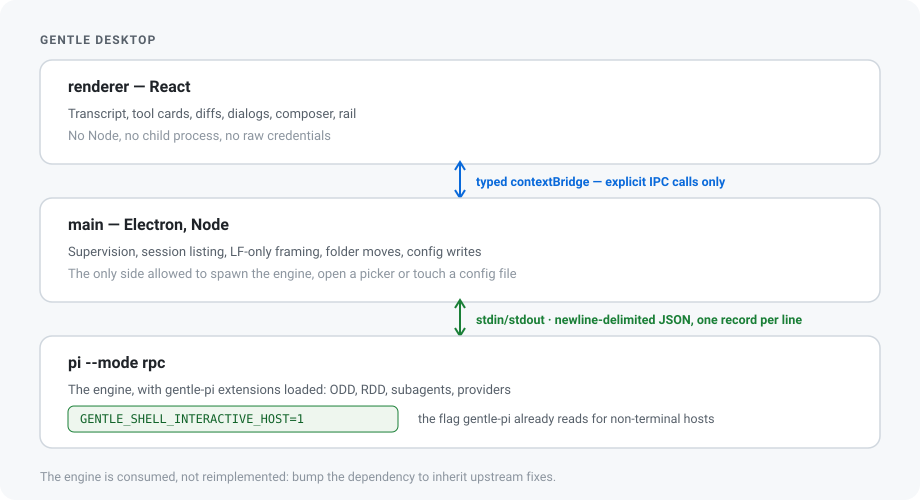
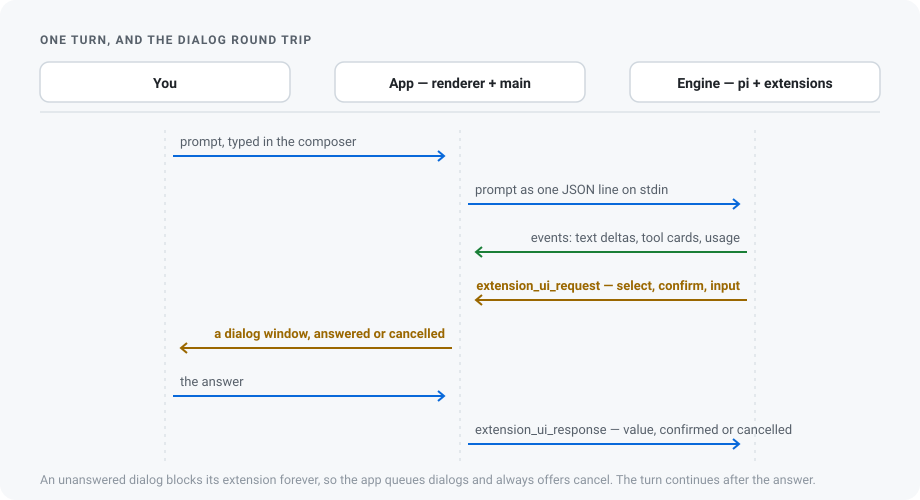
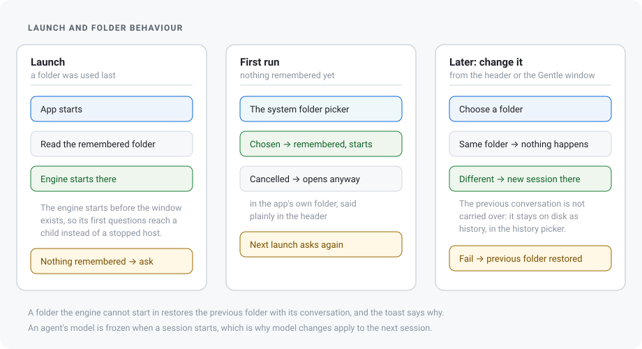

# Gentle Desktop

[](https://github.com/leav-dev/gentle-desktop/actions/workflows/ci.yml)
[](LICENSE)

The Gentle Shell experience outside a terminal: the same `pi` engine, the same gentle-pi
extensions, and a desktop surface in place of the TUI.

Gentle Shell renders its whole interface inside the terminal and spawns `pi` as a child
process. This project keeps that engine and replaces only the render layer, so ODD
tracking, RDD review gates, subagents and extensions behave exactly as upstream defines
them.

> Independent project. Not affiliated with, endorsed by, or sponsored by the Gentle Shell
> project or Earendil Works. See [NOTICE](NOTICE) before you publish a build.
>
> Part of the community around the Gentle tooling, filed under the
> [`gentle-hub-project`](https://github.com/topics/gentle-hub-project) topic. The name is a
> working title: it stays until upstream confirms whether it may be kept.

## What you get

| Surface | What it does |
| --- | --- |
| Transcript | Assistant output as real Markdown with highlighted code, tool cards with live status and diffs, thinking shown apart from text |
| Composer | Prompts, steering, and a `/` that opens the command palette with what you typed |
| Command palette · `Ctrl+K` | Every command the engine exposes, filtered as you type, run exactly as if typed (`/gentle:…`) |
| History · `Ctrl+H` | Saved conversations read from pi's own session files and reopened in place |
| Agents · `Alt+A` | Which subagents are running and what they are doing, live |
| Gentle · `Alt+K` | The settings hub: models, permissions, folder, subagents, providers, all commands |
| Models | The engine's profiles, which one is active, and the model each agent and the orchestrator use |
| Permissions | The four permission modes, the mode saved as the default, and who can change it |
| Providers · `Ctrl+,` | Register a provider with OAuth or an API key, or add one with its own server address and test it |
| Folder | Opens the last folder used, asks for one on a first run, and starts a new session when you change it |
| Top bar | Model and thinking level, context usage, session cost, repository state, subscription quota, permission-mode badge |
| Rail | Status and the ODD tasks this repository tracks, and nothing it has no data for |

## Quick start

```bash
git clone git@github.com:leav-dev/gentle-desktop.git
cd gentle-desktop
pnpm install
pnpm dev
```

The app starts its own engine on launch. On a first run it asks which folder to work in and
remembers the answer; later launches open that folder without asking.

**Requirements**

- Node.js 22 or newer in development, pnpm 10 or newer.
- An Electron release that bundles **Node.js 22 or newer** (Electron 35+; the project pins a
  current release). This is not cosmetic: pi's bundle imports `node:module`'s
  `enableCompileCache`, so an older Electron opens the window and then fails to start the
  engine. Electron runs pi with `ELECTRON_RUN_AS_NODE=1`, which is what makes the installer
  independent of any Node installed on the user's machine.

## How it works



The engine is not reimplemented. `pi --mode rpc` is a documented bidirectional protocol,
and `GENTLE_SHELL_INTERACTIVE_HOST=1` is the flag gentle-pi already reads to route
`ask_user_question`, `ask_user_choice`, permission confirmations and live subagent activity
to a host that is not a terminal. This app is that host.

Three consequences worth knowing:

- **No tool-approval event exists.** pi never blocks on approvals; permission decisions are
  extension-owned and surface as `select`/`confirm` dialogs. The app renders those dialogs,
  which is why permissions need no separate integration.
- **Sessions are listed from disk.** pi has no list-sessions command, so the main process
  reads the session files and reopens one with `switch_session`.
- **Framing is LF-only.** Records are split on `\n` and nothing else; Node's `readline` also
  splits on U+2028/U+2029 and corrupts message payloads.

### One turn, and the dialog round trip



An unanswered dialog blocks its extension forever, so the app queues dialogs, presents them
one at a time, and always offers cancel.

## Folders and sessions



A session works in one folder. Changing the folder is a new piece of work, not a move: the
engine starts a session of its own there, and the previous conversation stays on disk as
history instead of being carried over.

## Where things live

| Thing | Location |
| --- | --- |
| Agent home (pi's settings, credentials, sessions) | `~/.gentle-shell/agent` when Gentle Shell is installed, otherwise `~/.pi/agent`; `GENTLE_SHELL_HOME` overrides it |
| Engine config (profiles, permission default) | `GENTLE_PI_CONFIG_HOME`, then an absolute `GENTLE_SHELL_CONFIG_HOME`, then `~/.gentle-shell/gentle-ai`, then `~/.pi/gentle-ai` |
| Remembered folder | the app's own `userData` folder, never the repository |

The app resolves the engine config folder once and hands it to the engine it launches, so
the Models window and the engine always read the same `profiles.json`. Credentials are
never copied or moved: they stay in pi's own store.

## Known limits

- **Permission modes cannot be raised from the app.** gentle-pi grants elevated modes only to
  an interactive terminal session (`ctx.mode === "tui"`), so `/gentle:mode yolo` answers "Mode
  unchanged" over RPC. The Permissions window shows the saved default and names the route that
  works: set it in a terminal, and the next session here starts with it.
- **An agent's model change applies to the next session.** A session freezes its profile when
  it starts. The orchestrator's model does change live in the running session.
- **Profile creation, renaming and deletion stay in the terminal**, together with the
  materialization that the terminal performs for tools that read rendered routing files.
- **Some terminal surfaces have no desktop window yet.** Commands the terminal opens through
  `ctx.ui.custom` (panel, changes, stats, jobs, guide, customize, music, prompt history) cannot
  render over RPC; where the extension guards the call it reports that it needs TUI mode.
- **Builds are unsigned.** The Windows installer skips executable editing so anyone can
  reproduce it (see [Package it](#package-it)); expect SmartScreen to warn.

## Checks

```bash
pnpm typecheck          # both projects, strict
pnpm build              # main, preload and renderer bundles
pnpm test               # the whole suite, including a fake-engine harness for the host
pnpm test:engine        # integration: spawns the real engine, asserts extensions load
```

`test:engine` starts a real `pi --mode rpc` child, so it takes tens of seconds. It proves
the two claims this architecture rests on: the child answers `get_state`, and `get_commands`
contains gentle-pi commands, meaning the extensions loaded inside pi.

CI runs `typecheck, tests, build` on Windows for every push to `main` and every pull
request. Packaging runs only for tags, on Windows, macOS (Apple Silicon and Intel) and
Linux, and the release job attaches those packages.

## Package it

```bash
pnpm dist
```

Installers land in `release/`. Verify what actually went inside before shipping it:

```bash
node scripts/verify-package.mjs
```

It fails when the packaged build is missing the engine, the gentle-pi extensions or the
renderer bundle — a build can succeed while shipping an app that cannot start an agent.

Targets: NSIS installer on Windows (per-user, no elevation), DMG on macOS, AppImage on
Linux.

On Windows the installer step needs symlink privileges: electron-builder extracts its
signing toolchain into the user cache and fails with
`Cannot create symbolic link ... privilege required` on an account without that right.
Either enable Windows Developer Mode, or build the runnable directory without an installer:

```bash
CSC_IDENTITY_AUTO_DISCOVERY=false npx electron-builder --dir
```

That produces `release/win-unpacked/Gentle Desktop.exe`, which is the full app.

Always close a running build before repackaging. Rewriting `release/` while the app holds
its own files leaves a half-written package that starts and exits with code 1 and no
message — Windows refuses to replace a mapped executable, and nothing warns you.

## Layout

| Path | Role |
| --- | --- |
| `src/main/rpc/launch.ts` | resolves the pi bundle and builds the child launch plan (argv, env, config home) |
| `src/main/rpc/transport.ts` | newline-delimited JSON framing, request correlation, dialogs |
| `src/main/rpc/host.ts` | one supervised engine child, restarts, dialog bookkeeping, folder moves |
| `src/main/config-home.ts` | the one config folder the app and its engine both read |
| `src/main/model-routing.ts` | reads and writes the engine's profiles and the orchestrator default |
| `src/main/workspace.ts` | the working folder: its label, the remembered choice, the startup decision |
| `src/main/sessions.ts` | session listing derived from pi's session files |
| `src/shared/protocol.ts` | the RPC wire types, including the dialog subprotocol |
| `src/shared/ipc.ts` | the main↔renderer contract |
| `src/renderer/` | the React surface |
| `odd/tasks/gentle-desktop.md` | the specification, task list and decision log for this fork |
| `docs/` | the architecture, dialog-flow and folder-lifecycle diagrams in this README |
| `design/` | the design system and the layout artboards this surface was built from |

## Upstream relationship

The engine is consumed as published npm dependencies, not vendored:

- `@earendil-works/pi-coding-agent` — the agent runtime and RPC mode
- `gentle-pi` — the Gentle Shell extensions, ODD and RDD

Engine fixes therefore stay reachable by bumping a version. Code is vendored only for a
patch that cannot be expressed as an extension.

## Contributing

Work is tracked in [`odd/tasks/gentle-desktop.md`](odd/tasks/gentle-desktop.md): each
specification quotes the user's words, each task names its spec, and the log records
decisions with evidence. Read the tasks before changing behavior, and keep tests and
documentation in the same commit as the code they describe.

## License

MIT. See [LICENSE](LICENSE), which preserves the upstream notices.
